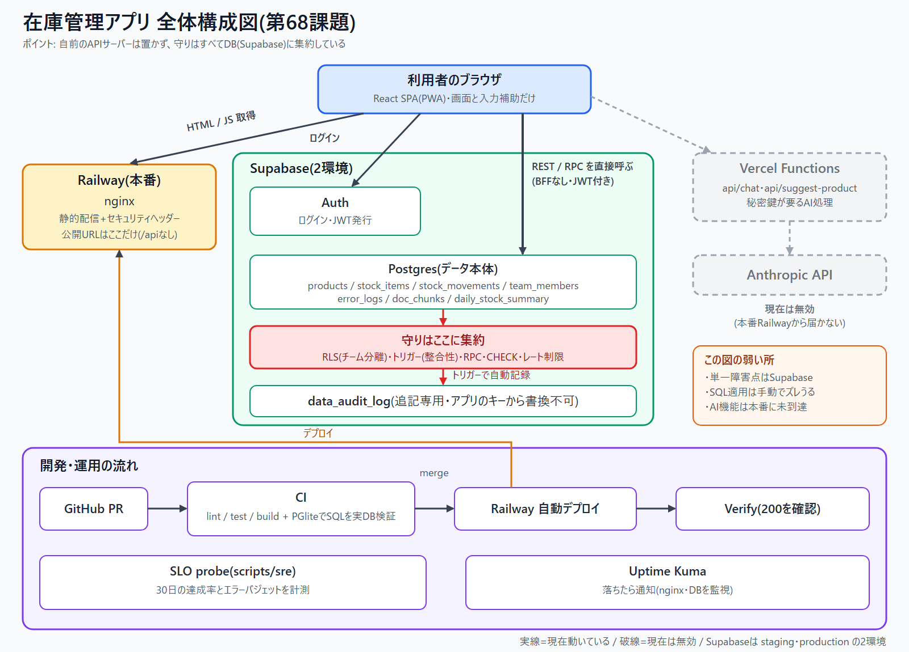
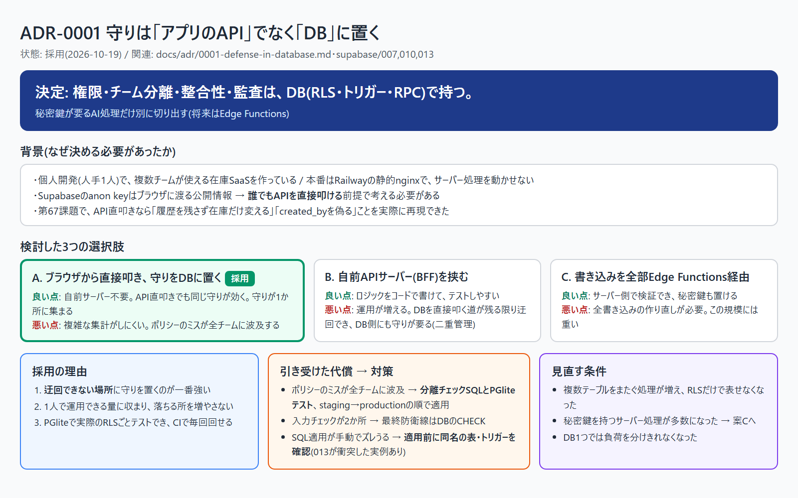
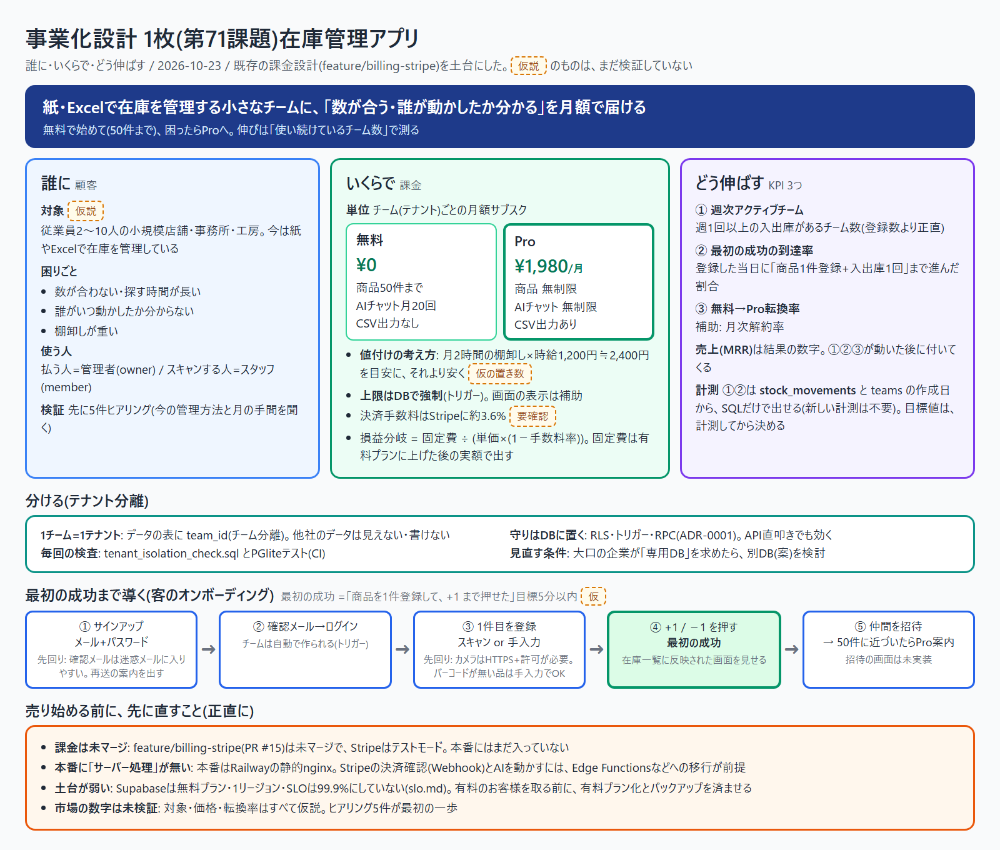

# アーキテクト提案書：在庫管理SaaS（第72課題・修了総合演習）

作成日: 2026-10-23 / 作成者: yassyan-code
本番: https://inventory-app-production-64fe.up.railway.app （2026-10-23 に HTTP 200 を確認）
リポジトリ: https://github.com/yassyan-code/inventory-app

各章は、これまでの課題で作った文書への要約と入口。詳細は「根拠」の文書を見る。
**「実装済み」「未実装」「仮説」を分けて書く。** 動いていない物を動いているように書かない。

## 0. 一言と、一番の推しポイント

> 小さなチームの在庫を「数が合う・誰が動かしたか分かる」状態にする。守りは、迂回できないDBに置く。

**推しポイント: 守りをDBに置いた判断（ADR-0001）。** 「たぶん安全」で決めず、API直叩きで「履歴を残さず在庫だけ変える」「他人の ID を `created_by` に書く」ことを**実際に再現**してから決めた。再現した穴は、DBのトリガーで塞いだ。

## 1. 課題と対象

- 誰の何: 紙・Excelで在庫を管理する小規模チーム（従業員2〜10人、仮説）。数が合わない・誰が動かしたか分からない・棚卸しが重い
- 規模の前提: 開発・運用は1人。落ちる所を増やさないことを最優先にする
- 根拠: `docs/spec.md`、`docs/scale-bottleneck.md`

## 2. アーキテクチャ

- ブラウザ(React SPA/PWA) → Supabase(Auth・Postgres)を**直接**呼ぶ。自前のAPIサーバー(BFF)は置かない
- 本番の公開はRailwayの静的nginxだけ。AIの処理(Vercel Functions)は、本番から届かないため現在は無効
- 守りは Supabase の RLS・トリガー・RPC に集約。監査ログは追記専用
- 開発は PR → CI(lint・test・build、SQLはPGliteで実DB検証) → マージ → Railway自動デプロイ → Verify

- 設計判断: 3案（A: DBに置く / B: 自前API / C: Edge Functions経由）を比べ、Aを採用。代償（ポリシーのミスが全チームに波及・SQL適用が手動）と、見直す条件も書いた
- 根拠: `docs/architecture-overview.md`、`docs/adr/0001-defense-in-database.md`、`docs/spof.md`

## 3. AI機能

| 機能 | 形 | 状態 |
|---|---|---|
| 商品名の整形+カテゴリ提案 | 構造化出力（ツール呼び出しを強制し、サーバーで検証） | 実装済み・Claude APIで動作確認・テスト33件。**本番には届いていない** |
| 資料への質問（RAG） | docs 19件→143チャンク→ベクトル検索→根拠の機械照合 | ローカルで動作。評価12問で 検索7/10・根拠8/10・資料に無い質問2/2。**Supabaseには未適用** |
| 在庫を調べるエージェント | 読み取り道具2つ+書き込み道具1つ（許可リスト） | ローカルで動作。3点満点の機械採点。安全ガード（回数・トークン・時間・保存先の固定）をコードで強制、テスト11件 |

- 設計の考え方: AIは補助。失敗しても手入力で進める。AIの出力は信用せず検証してから使う。書き込める道具を最小にする
- 根拠: `docs/ai-structured-output.md`、`docs/rag.md`、`docs/agent.md`

## 4. 信頼性（SLO・可観測性）

- 目標: 画面が開く 99.5% / データ基盤に繋がる 99.5% / 画面が速い（1秒未満）95%。99.9%にしないのは、Railway1台・Supabase無料プランでは守れないから
- 仕組み: 測定(`probe.mjs`) → 計算(`slo.mjs`、純粋な関数でテスト) → 表示(`report.mjs`)。エラーバジェットと燃焼率で「注意・緊急・凍結」を判定
- 役割分担: 落ちた瞬間の通知は Uptime Kuma、「30日で目標を守れているか」は SLO
- **この章は提案書の中で一番弱かった（次章）**
- 根拠: `docs/slo.md`、`docs/slo-dashboard.html`、`docs/incident-runbook.md`、`docs/postmortem-*.md`

## 5. セキュリティ

- 脅威モデル: データの流れ図 → 信頼境界 → 4観点（なりすまし・改ざん・漏洩・妨害）で総当たり
- 実際に塞いだ穴: 013で `data_audit_log`（追記専用）と `created_by` の強制をDBに追加。013なしでは再現できた3つの迂回が、013ありでは起きない（PGliteテスト9件がCIで毎回走る）
- チーム分離: RLS +`tenant_isolation_check.sql`。分離が壊れていないかを毎回検査
- 正直な弱点: SQLの適用が手動で、リポジトリとDB実体がずれうる（013がstagingの既存 `audit_log` と衝突して一度失敗した → 改名して解決）
- 根拠: `docs/threat-model.md`、`docs/threat-model-stride.md`、`docs/tenant-isolation-test.md`

## 6. 事業計画

- 課金: チーム単位の月額。無料¥0（商品50件・AIチャット月20回）/ Pro ¥1,980（無制限・CSV）。上限はDBのトリガーで強制
- KPI: 週次アクティブチーム / 最初の成功の到達率 / 無料→Pro転換率。計測は既存の `stock_movements` からSQLで出せる
- **すべて仮説。** 対象・価格・転換率は、ヒアリング5件で確かめるまで確定しない
- 課金の実装は未マージ（`feature/billing-stripe`、Stripeはテストモード）

## 7. 弱い所を実際に強くした（修了演習のステップ②）

**提案書の中で一番弱い章は「4. 信頼性」だった。** 理由:

- 他の章は「作った」と「検証した」が揃っている（脅威はPGliteで再現・防御、AIは評価で採点）
- 信頼性だけは、目標（99.5%）を決めて計算の仕組みも作ったのに、**測定が定期的に走っていなかった**。`slo.md` 自身が「99.5%を守れている証明ではない」と書いていた。目標が、裏付けのない数字だった

**強くしたこと（今回の変更）:**

- `.github/workflows/slo-probe.yml`: 10分おきに本番（Web・Supabase）をGETで測り、履歴を `slo-data` ブランチに保存する。履歴は1コミットに上書きするので、コミットが増え続けない。実行のたびに、今の状態を要約に出す
- `scripts/sre/retain.mjs`: 履歴を31日で切る（壊れた行は捨てる）。テスト4件を追加（全体で64件パス）

**確かめたこと / まだ確かめていないこと:**

- 確かめた: 測定→切り詰め→レポートの流れを実際に実行。保存の手順は、ローカルの空リポジトリで3回保存して「コミット1つのまま・履歴が取り出せる」ことを確認
- **未確認: GitHub Actions上での実行。** cronはマージ後にしか動かない。マージしたら `workflow_dispatch` で1回手動実行して確かめる
- 限界: GitHubのcronは遅れる・間引かれる。測定地点は1か所。リポジトリに60日更新がないと止まる。**30日貯まるまでは、SLOを評価できない**

## 8. 現在地と、次の一手

| 章 | 状態 |
|---|---|
| アーキテクチャ | 図・ADR・SPOFまで揃った。SQL適用が手動 |
| AI | 3種とも動くが、**本番に届いていない** |
| 信頼性 | 定期測定を追加（未マージ）。30日の実績はこれから |
| セキュリティ | 脅威モデル・監査ログ・分離検査まで揃った |
| 事業 | 設計1枚のみ。課金は未マージ、顧客の検証はゼロ |

**次の一手の宣言（案）:**

1. **Edge Functionsへ移行して、AI・課金を本番に届ける。** 3章のAIと6章の課金は、どちらもこれが前提。今はサーバー処理が本番に無い
2. このPRをマージし、SLOを30日測って「99.5%を守れているか」を初めて評価する
3. 顧客候補5件にヒアリングし、対象・価格・KPIの仮説を確かめる
4. 終わったら、チームに渡す（第70課題のオンボーディング手順を、実際の初心者に試してもらう）

## 9. 5分発表の台本

**推し: 守りをDBに置いた判断。** 時間配分の目安付き。

- **0:00〜0:30 導入**
  「在庫が合わない、誰がいつ動かしたか分からない。そんな小さなチームのための在庫管理アプリを、1人で作り、本番で動かしています。今日は、その全体と、一番の判断を話します」
- **0:30〜1:30 全体像（図を見せる）**
  「ブラウザからSupabaseを直接使います。自前のAPIサーバーはありません。本番はRailwayの静的配信だけです。落ちる所を増やさない構成です」
- **1:30〜2:30 推し：守りはDBに置く**
  「Supabaseの鍵はブラウザに渡る公開情報なので、誰でもAPIを直接叩けます。実際に、履歴を残さず在庫だけ変える、他人の名前で記録を書く、を再現できました。API サーバーを足しても、DBを直接叩く道が残る限り迂回できます。だから守りを、迂回できないDBに置きました。トリガーで監査ログを追記専用にして、毎回CIでテストしています。代償は、SQLの適用が手動でずれうることです。実際に一度、衝突して失敗しました」
- **2:30〜3:15 AI**
  「AIは3種類入れました。商品名の整形、資料への質問、在庫を調べるエージェントです。方針は、AIの出力を信用せず検証すること、書き込める道具を最小にすること、失敗しても手入力で進めることです。正直に言うと、どれも本番にはまだ届いていません」
- **3:15〜3:50 信頼性：弱い所を直した**
  「提案書で一番弱かったのは信頼性でした。99.5%という目標はあるのに、定期的に測っていなかったのです。そこで10分おきの自動測定を足しました。ただし30日貯まるまでは、守れている証明にはなりません」
- **3:50〜4:30 事業**
  「無料50件、Proは月1,980円のチーム課金を設計しました。ただし、価格も対象も、まだ仮説です。ヒアリング5件が最初の一歩です」
- **4:30〜5:00 次の一手**
  「次は、Edge Functionsへ移行して、AIと課金を本番に届けること。そして、測定を30日続けて、目標を守れているかを数字で言えるようにすることです」

質問が来たら: 「なぜBFFにしなかったのか」→ 3案の比較とADR-0001。「SLOは守れているか」→ まだ言えない、30日測る。「売れるのか」→ 仮説、ヒアリングから。
