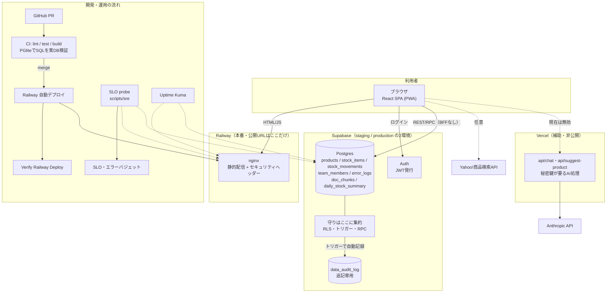

# 全体像（第68課題・大規模の構成図）

作成日: 2026-10-19。第55課題の `architecture.md` は「作る前の図」。
これは第56〜67課題で増えた部品（監査ログ・SLO・エージェント・テスト基盤）を足した「今の姿」。
事実は `docs/` の各文書と `supabase/` のSQLに合わせた。

## 構成図

## 部品と役割

- ブラウザ（React SPA）: 画面、入力チェックの利便性だけ。権限の本物の判定はここに置かない
- nginx（Railway）: 静的ファイルとセキュリティヘッダー。`/api/*` は存在しない
- Supabase Auth: ログインとJWT発行
- Supabase Postgres: データ本体。チーム分離(RLS)、整合性(010)、監査(013)、レート制限(009)をすべてDB側に持つ
- 監査ログ: 商品・在庫・所属の変更をDBのトリガーが記録。アプリのキーからは書き換え不可
- Vercel Functions: Anthropicキーが要る処理だけ。本番(Railway)からは届かないので現在は無効（Edge Functions移行が前提）
- CI: lint・テスト・ビルド。SQLはPGlite（ローカルPostgres）で実際のRLSごと検証
- 監視: Uptime Kuma（落ちたら通知）、SLO probe（30日の達成率とバジェット）

## 主な流れ

- 在庫を+1: ブラウザ → Supabase(JWT付きでupdate) → RLSが自チームか判定 → トリガーが履歴と監査ログを記録
- ログイン: ブラウザ → Supabase Auth → JWT → 以降のDB呼び出しに自動で付く
- リリース: PR → CI合格 → merge → Railwayが自動デプロイ → Verifyが200を確認
- SQL変更: リポジトリのSQL → stagingで適用・確認 → productionに適用（手動。Supabase SQL Editor）

## この図の弱い所（正直に）

- 単一障害点: Supabase（Auth+DB）が最大。Railwayは1台。詳細は `spof.md`
- マイグレーションの適用は手動で、リポジトリとDB実体がずれうる（第67課題でstagingのaudit_log衝突が実際に起きた）
- AI機能は本番に届いていない（図の点線）
